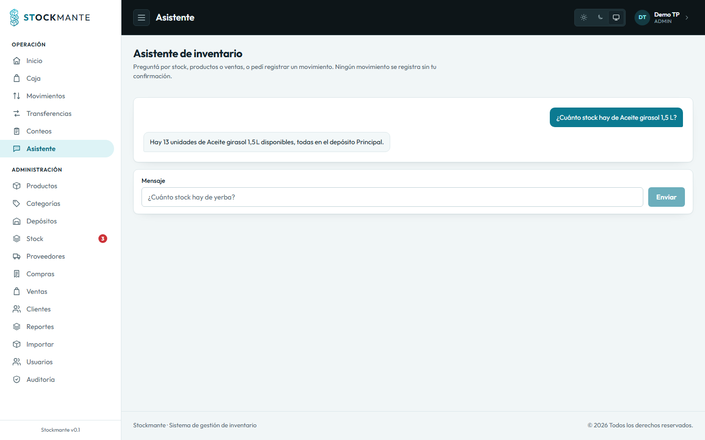

# Stockmante

Sistema web de **gestión y control de inventario**:
autenticación con sesión única, usuarios y roles, catálogo de productos y categorías, depósitos y ubicaciones
jerárquicas, movimientos de stock atómicos, compras, ventas, inventario físico, reportes,
auditoría, alertas y un **asistente de inventario con LangChain**.

- **Backend**: Rust + Axum 0.8 + SQLx (PostgreSQL)
- **Frontend**: SvelteKit (SPA) + Tailwind CSS 4 + Zod
- **Base de datos**: PostgreSQL 15+ (probado con 18)
- **Asistente**: Node 24 + LangChain.js + Groq/OpenAI/Anthropic
- **Documentación de API**: OpenAPI 3.1 + Swagger UI (`utoipa`)
- **Desarrollo asistido**: Spec Kit (SDD), skills de agente, MCP PostgreSQL (DBHub) y MCP Playwright

## Arquitectura

```text
Navegador (SvelteKit SPA + Tailwind)
   │  fetch tipado, cookie HttpOnly, credentials: include
   ▼
Axum (backend/)
   ├── handlers/     HTTP, DTOs, extractores, autorización
   ├── services/     reglas de negocio y transacciones SQLx
   ├── models/       structs + validaciones puras
   ├── auth/         sesión, RBAC, contraseñas, gate de cambio obligatorio
   ├── mail/         SMTP o stub de consola
   └── docs.rs       OpenAPI + Swagger UI
   ▼
PostgreSQL 18 (migrations/ 0001–0015)
   ▲
   │  API Rust con la cookie del usuario
Asistente Node 24 (LangChain.js)
   └── tools: consultar_stock, buscar_producto, listar_depositos,
              resumen_ventas, reporte_agregado, proponer_movimiento

Herramientas de desarrollo (no forman parte del runtime):
MCP PostgreSQL (DBHub, readonly) · MCP Playwright · Spec Kit · skills
```

Detalle de capas, transacciones, RBAC y modelo de datos en
[`docs/arquitectura.md`](./docs/arquitectura.md). Contrato HTTP en
[`docs/api.md`](./docs/api.md) y Swagger UI en `/docs`.

## Puesta en marcha

### Requisitos

- Rust 1.88 o superior (probado con 1.99).
- **Node 24** para el asistente (usa TypeScript nativo y `--env-file-if-exists`). El frontend
  funciona con Node 20.19+.
- PostgreSQL 15 o superior con las bases `stockmante` y `stockmante_test`.
- `sqlx-cli` (`cargo install sqlx-cli --no-default-features --features rustls,postgres`) para
  migraciones y `cargo sqlx prepare --check`.

### 1. Base de datos

```sql
CREATE ROLE stockmante LOGIN PASSWORD 'stockmante';
CREATE DATABASE stockmante OWNER stockmante;
CREATE DATABASE stockmante_test OWNER stockmante;
```

### 2. Variables de entorno

Copiar `.env.example` a `.env` y ajustar. Las claves principales:

| Variable                                       | Uso                                                                        | Default                            |
| ---------------------------------------------- | -------------------------------------------------------------------------- | ---------------------------------- |
| `DATABASE_URL`                                 | Conexión PostgreSQL                                                        | —                                  |
| `APP_URL`                                      | CORS + links de correo                                                     | `http://localhost:5173`            |
| `PORT`                                         | Puerto del backend                                                         | `3000`                             |
| `APP_ENV`                                      | `development` / `production`                                               | `development`                      |
| `DOCS_ENABLED`                                 | Swagger UI y OpenAPI                                                       | `true` en dev, `false` en prod     |
| `SESSION_COOKIE_NAME` / `SESSION_EXPIRY_HOURS` | Sesión                                                                     | `stockmante_sesion` / `8`          |
| `SMTP_URL`                                     | Correo real; vacío en dev = stub de consola                                | —                                  |
| `PUBLIC_API_URL`                               | API que usa el frontend                                                    | `http://localhost:3000`            |
| `GOOGLE_CLIENT_ID/SECRET`, `MICROSOFT_*`       | SSO (opcional)                                                             | —                                  |
| `ASISTENTE_URL`                                | URL del servicio LangChain; vacía = `/api/asistente/consulta` responde 503 | —                                  |
| `ASISTENTE_TIMEOUT_SEGUNDOS`                   | Timeout por consulta                                                       | `30`                               |
| `ASISTENTE_PUERTO`                             | Puerto del servicio                                                        | `3100`                             |
| `API_BASE_URL`                                 | API que consumen las tools del asistente                                   | `http://localhost:3000`            |
| `LLM_PROVIDER`                                 | `anthropic`, `openai` o `groq`                                             | `anthropic`                        |
| `LLM_API_KEY`                                  | Clave del proveedor                                                        | —                                  |
| `LLM_MODEL`                                    | Modelo (obligatorio con `openai`/`groq`)                                   | `claude-sonnet-5-5` para Anthropic |

### 3. Migraciones y datos iniciales

```bash
sqlx migrate run

cd backend
cargo run --bin bootstrap
```

`bootstrap` crea el depósito «Principal» y el admin inicial. En desarrollo imprime la contraseña
temporal; el primer login obliga a cambiarla. Para regenerarla:
`cargo run --bin bootstrap -- --reset-admin-password` (prohibido con `APP_ENV=production`).

### 4. Backend

```bash
cd backend
cargo run --bin stockmante-backend
```

### 5. Frontend

```bash
cd frontend
npm install
npm run dev
```

SPA en <http://localhost:5173>; usa `PUBLIC_API_URL` (default `http://localhost:3000`).

### 6. Asistente (opcional, criterio 5)

```bash
cd asistente
npm install
npm start
```

Requiere Node 24, `LLM_PROVIDER`, `LLM_MODEL` (excepto Anthropic con default) y `LLM_API_KEY`;
en el backend, `ASISTENTE_URL=http://127.0.0.1:3100`. Sin eso, `/api/asistente/consulta`
responde `503 asistente_no_disponible` con un mensaje accionable (degradación controlada).

## Demo del asistente (LangChain)

1. Levantar backend, frontend y asistente (tres terminales).
2. Iniciar sesión como `GESTION` y abrir **/asistente**.
3. Probar:
   - «¿Cuánto stock hay de `<producto>`?» → responde con datos reales de las tools.
   - «Buscá `<texto>`» → lista productos.
   - «¿Cómo fueron las ventas de los últimos 7 días?» → resumen.
   - «Registrá una entrada de 5 unidades de `<producto>` en Principal» → tarjeta de propuesta.
4. Confirmar la propuesta: el frontend llama a `POST /api/movimientos`; el backend valida
   permisos, ejecuta la transacción y audita con el usuario real. La UI muestra el stock
   resultante.
5. Cancelar otra propuesta: no se escribe nada.

**Diseño de seguridad**: el asistente **nunca** escribe en la base. Las tools de lectura usan la
API con la cookie del usuario; las escrituras se proponen y el usuario las confirma por la API
normal. Límites: 20 consultas/minuto por usuario, 30 s por consulta, historial de 10 mensajes
solo en memoria, logs solo con metadatos.

**Evidencia real**: [`docs/evidencia-asistente.md`](./docs/evidencia-asistente.md) y
[`specs/017-asistente-inventario/evidencia/asistente-demo.png`](./specs/017-asistente-inventario/evidencia/asistente-demo.png).
Se verificó con Groq (`openai/gpt-oss-20b`): consulta de stock, propuesta sin escritura,
confirmación por `POST /api/movimientos` (movimiento 10, stock resultante 13) y auditoría.



Si ves `503`, revisá `ASISTENTE_URL`, que el servicio esté corriendo y que `LLM_API_KEY` esté
definida. Si ves `429`, esperá un minuto. Si ves `504`, acortá la consulta o subí
`ASISTENTE_TIMEOUT_SEGUNDOS`.

## AI Engineering

El proceso está documentado en detalle en [`docs/ai-engineering.md`](./docs/ai-engineering.md).
Resumen:

- **Entorno**: OpenCode/DeepSeek Harness, Spec Kit, skills de Spec Kit, MCP PostgreSQL y
  Playwright, Playwright para capturas, Vitest/Cargo/svelte-check, Git con commits
  convencionales.
- **Contexto**: constitución (`.specify/memory/constitution.md`) → `AGENTS.md` → `SKILLS.md` →
  specs por caso de uso → `plan.md`/`tasks.md`.
- **Flujo SDD**: `/speckit.specify` → `clarify` → `plan` → `tasks` → `implement` → `analyze` →
  `converge`. Las specs se escriben antes del código; los contratos HTTP y los criterios de
  aceptación se fijan antes de implementar.
- **Prompts clave**: el pedido inicial del Módulo 1, el pedido de documentación/MCP, el pedido
  del asistente, el rediseño de escritorio y el rediseño móvil. Extractos verbatim y enlaces en
  [`docs/ai-engineering.md`](./docs/ai-engineering.md).
- **Iteración y autocorrección**: RED → GREEN, gates (`cargo test`, `cargo sqlx prepare
--check`, `npm test`, `npm run check`, `npm run build`), `/speckit.analyze` y
  `/speckit.converge`, verificación de esquema por MCP y waivers explícitos W-001…W-006.
- **Evidencia**: 21 specs, 155 archivos `.md`, 20 planes, 20 tasks, 94 commits.

## MCP (Model Context Protocol)

La configuración de proyecto está en [`opencode.json`](./opencode.json). El detalle y las
pruebas manuales están en [`docs/mcp.md`](./docs/mcp.md).

| Servidor                         | Origen                          | Transporte  | Rol en el desarrollo                                                                                                            |
| -------------------------------- | ------------------------------- | ----------- | ------------------------------------------------------------------------------------------------------------------------------- |
| `postgres` (DBHub)               | **Externo** (`@bytebase/dbhub`) | stdio local | Verificar el esquema real antes de escribir SQL/migraciones; explorar datos; solo lectura (`readonly = true`, `max_rows = 200`) |
| `playwright` (`@playwright/mcp`) | **Externo**                     | stdio local | Validación visual/E2E y capturas sobre el frontend en Vite                                                                      |
| Context7 (opcional)              | Externo remoto                  | HTTP        | Documentación de librerías; no es necesario para el mínimo                                                                      |

Requisitos: `DATABASE_URL` en `.env`, `npx` y Node 20+. `dbhub.toml` referencia
`${DATABASE_URL}` y nunca versiona credenciales.

**Evidencia** (spec 000): `initialize` → `DBHub MCP Server 1.5.0`; `tools/list` →
`execute_sql`; lectura OK; `CREATE TABLE` rechazado con `READONLY_VIOLATION`.
Playwright MCP inicia y navega contra `http://localhost:5173`. Ver
[`specs/000-plataforma-documentacion-mcp/progress.md`](./specs/000-plataforma-documentacion-mcp/progress.md).

> **MCP de inventario custom**: no se construyó. El asistente usa tools de LangChain contra la
> API autenticada; un MCP de escritura duplicaría permisos y reglas de stock. Los 2 MCP usados
> alcanzan el mínimo (2 servidores, ambos externos).

## Calidad

```bash
# Backend
cd backend
cargo test
cargo sqlx prepare --check

# Frontend
cd frontend
npm test
npm run check
npm run build

# Asistente
cd asistente
npm test
npm run check
```

Resultado de la última corrida (2026-11-07):

| Suite                        | Resultado                                                                  |
| ---------------------------- | -------------------------------------------------------------------------- |
| `cargo test`                 | **verde**; 296 funciones de test, 3 pruebas de carga ignoradas a propósito |
| `cargo sqlx prepare --check` | exit 0                                                                     |
| `npm test` (frontend)        | **388/388**                                                                |
| `npm run check` (frontend)   | 0 errores, 0 warnings                                                      |
| `npm run build` (frontend)   | OK (adaptador static)                                                      |
| `npm test` (asistente)       | **54/54**                                                                  |
| `npm run check` (asistente)  | tsc sin errores                                                            |

Reglas del proyecto: sin `unwrap()`, `expect()` ni `panic!` en rutas de producción; todo
movimiento de stock es transaccional; la lógica de acceso del frontend vive en
`frontend/src/lib/api/*.ts` y los componentes no llaman `fetch` directo.

## Evidencia visual

- Capturas base del sistema: [`captures/`](./captures/) (01–17).
- Rediseño de escritorio claro/oscuro y 320 px:
  [`specs/018-rediseno-visual-desktop/evidencia/`](./specs/018-rediseno-visual-desktop/evidencia/).
- Validación visual y de contraste: [`specs/018-rediseno-visual-desktop/evidencia/validacion.md`](./specs/018-rediseno-visual-desktop/evidencia/validacion.md).
- Rediseño móvil (parcial): [`specs/019-rediseno-visual-mobile/`](./specs/019-rediseno-visual-mobile/).

## Estructura

```text
backend/        API Axum, servicios, modelos, tests unitarios e integración
frontend/       SPA SvelteKit (/, /caja, /movimientos, /admin/*, /asistente)
asistente/      Servicio LangChain.js (spec 017)
migrations/     Migraciones SQLx (numeración global, no se reutiliza)
specs/          SDD: una spec por caso de uso (001–019) + índice y ledger
docs/           api, arquitectura, mcp, casos de uso, aceptación, AI engineering
scripts/        capturas Playwright, seeds y utilidades
captures/       Evidencia visual base
opencode.json   MCP de proyecto (PostgreSQL readonly + Playwright)
dbhub.toml      Configuración de DBHub (DSN desde DATABASE_URL)
```

## Documentación

- [`docs/casos-de-uso.md`](./docs/casos-de-uso.md): los 10 CUs, criterios, trazabilidad y evidencia.
- [`docs/aceptacion.md`](./docs/aceptacion.md): checklist del recorrido manual.
- [`docs/evidencia-asistente.md`](./docs/evidencia-asistente.md): transcript del chat real con Groq.
- [`docs/arquitectura.md`](./docs/arquitectura.md): capas, transacciones y modelo de datos.
- [`docs/api.md`](./docs/api.md): endpoints, auth y errores.
- [`docs/mcp.md`](./docs/mcp.md): servidores MCP y su rol.
- [`docs/ai-engineering.md`](./docs/ai-engineering.md): prompts, contexto, iteración y loops.
- [`specs/README.md`](./specs/README.md): mapa de specs, requisitos y ledger de migraciones.
- Swagger UI: <http://localhost:3000/docs> · OpenAPI JSON:
  <http://localhost:3000/api-docs/openapi.json>.

## Limitaciones conocidas

- **CU-09 parcial**: sin lectura por cámara ni generación/impresión de etiquetas. El lector
  físico (teclado) y la búsqueda por código exacto funcionan. La mejora quedó especificada en
  [`specs/020-escaneo-codigos-barra/`](./specs/020-escaneo-codigos-barra/spec.md) y su
  implementación está delegada a otro agente.
- **Spec 019 (móvil)**: implementación parcial (58/87 tareas); no forma parte de los 10 CUs.
- **Spec 018**: 12 tareas de validación manual pendientes; las suites y la evidencia visual
  están en verde.
- **Pruebas de carga ignoradas**: `SC-018`, `SC-024` y el envío SMTP real se corren a demanda,
  no en la suite normal.
- **Asistente**: requiere Node 24, un proveedor de LLM y el servicio levantado; sin eso responde
  503 de forma controlada.
